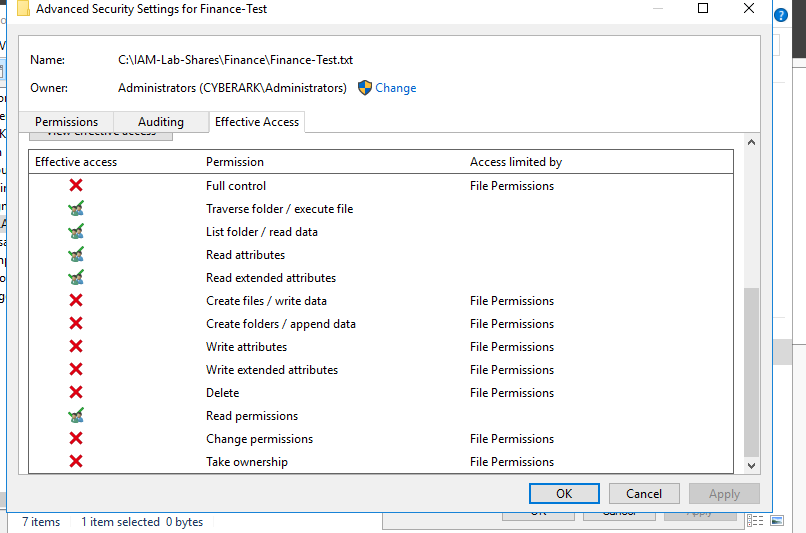
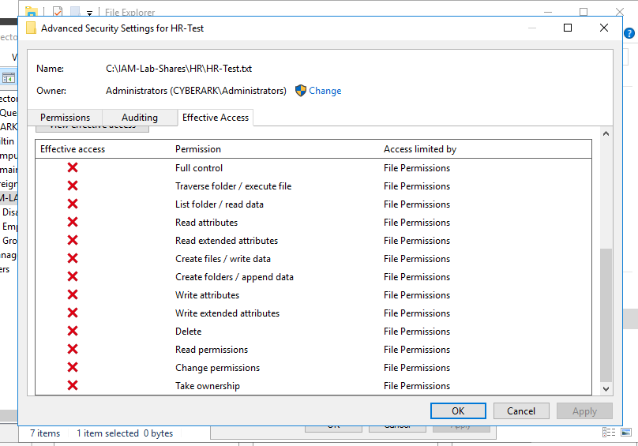
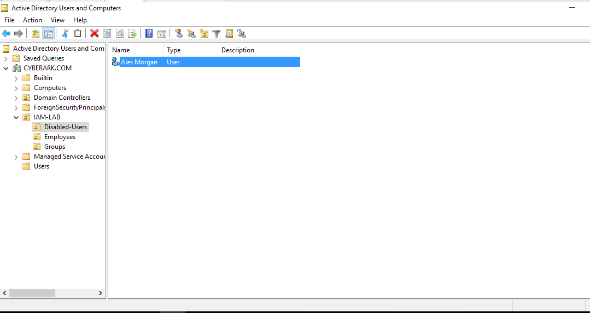
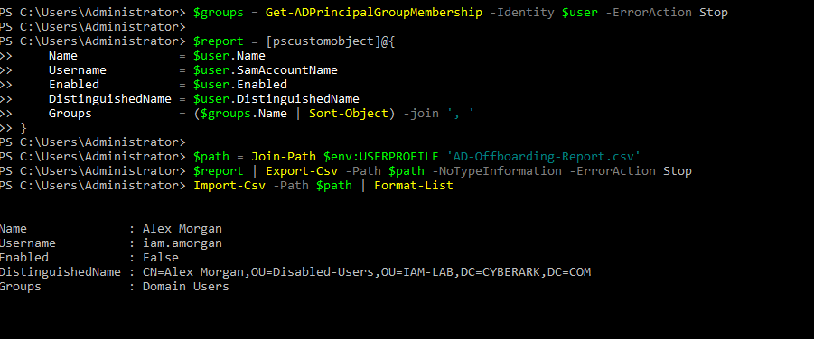

# Active Directory IAM Lifecycle Lab

I simulated an employee joining HR, transferring to Finance, and leaving
the company in an on-premises Active Directory lab. I used Global security
groups for department roles and nested them in Domain Local groups that
held NTFS permissions.

| Stage | HR file | Finance file |
|---|---|---|
| Joiner | Read allowed, write blocked | Read blocked |
| Mover | Read blocked | Read allowed, write blocked |
| Leaver | Read blocked | Read blocked |

I used Windows Effective Access to verify the file permissions at each
stage. During offboarding, I disabled the account, removed its Finance
role membership, and moved it to the Disabled-Users OU. I exported the
account status, directory location, and group membership to a CSV using
PowerShell and read the CSV back to verify the export.

## Lab evidence

**Finance read allowed and write blocked after transfer**

**HR read blocked after transfer**

**Alex moved to the Disabled-Users OU**

**Offboarding report verified in PowerShell**

